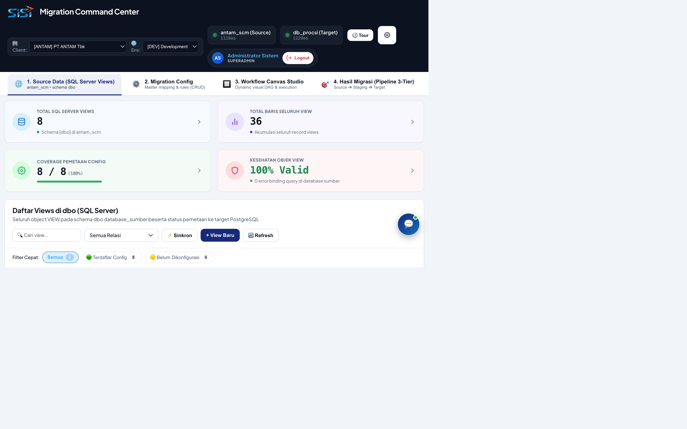
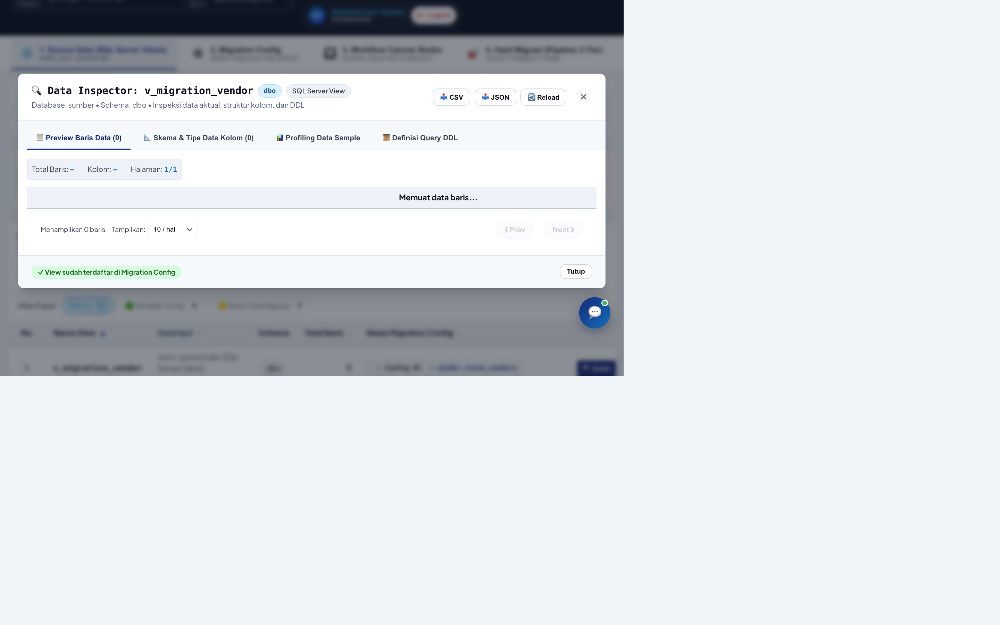
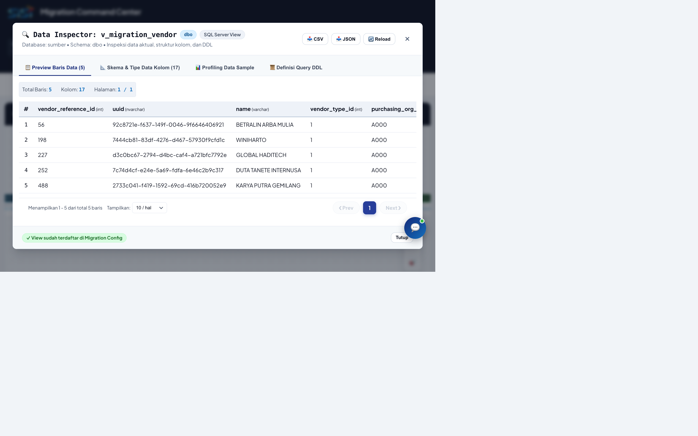
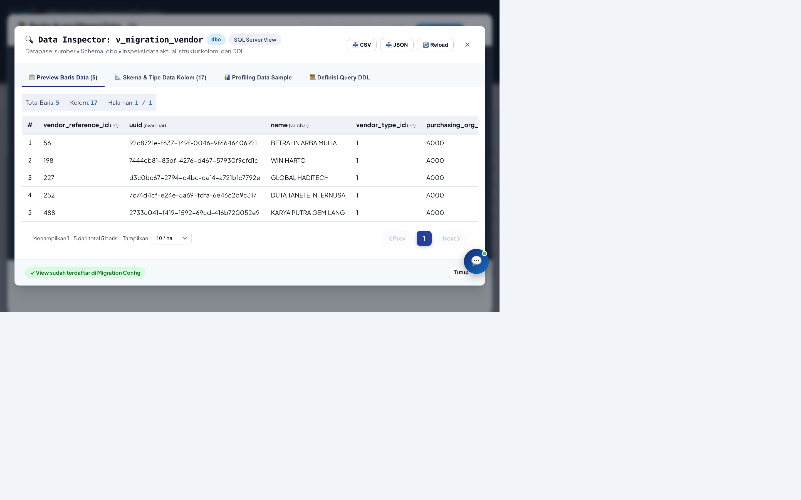

# Panduan Lengkap: Siklus Migrasi End-to-End (Source Data s/d Cetak Berita Acara)
### ETL Migration Command Center (MCC-PROCSI)
**Studi Kasus Riil 1 Siklus Penuh:** Migrasi Data Master Vendor (`Config #1: Vendor`) pada Client **PT ANTAM Tbk (DEV)**

---

## Daftar Isi
1. [Ringkasan Siklus & Arsitektur Migrasi](#1-ringkasan-siklus--arsitektur-migrasi)
2. [Tahap 1: Pemilihan Tenant & Inspeksi Source Data (SQL Server Views)](#tahap-1-pemilihan-tenant--inspeksi-source-data-sql-server-views)
   - 1.1 Verifikasi Header Tenant & Status Database
   - 1.2 Eksplorasi Katalog View Sumber
   - 1.3 Data Inspector (Pratinjau Data Riil SQL Server)
3. [Tahap 2: Konfigurasi 4 Master Data ETL (Migration Config)](#tahap-2-konfigurasi-4-master-data-etl-migration-config)
   - 2.1 Tab 1: Migration Config (Definisi Pipeline Inti)
   - 2.2 Tab 2: Convert Rules (Transformasi Kolom & Rumus)
   - 2.3 Tab 3: Target Config (Pemetaan Skema & Tabel Target)
   - 2.4 Tab 4: Master Lookup (Kamus Referensi Kode)
   - 2.5 Fitur Duplikasi Cepat (📋 Clone) untuk Mencegah Salah Ketik
4. [Tahap 3: Orkestrasi Visual Workflow Canvas Studio](#tahap-3-orkestrasi-visual-workflow-canvas-studio)
   - 3.1 Visualisasi DAG Interaktif (Source ➔ Staging ➔ Target)
   - 3.2 Penjelasan Mendalam 4 Alur Eksekusi (Flow 1 s/d Flow 4)
   - 3.3 Pemantauan Eksekusi: Terminal, Log Langkah, dan Riwayat Batch
5. [Tahap 4: Hasil Migrasi & Rekonsiliasi 3-Tier](#tahap-4-hasil-migrasi--rekonsiliasi-3-tier)
   - 4.1 Tabel Rekonsiliasi 3-Tier (Source vs Staging vs Target)
   - 4.2 Analisis Status Validasi (MATCH / MISMATCH) & Komparasi Data
6. [Tahap 5: Penerbitan & Cetak Berita Acara Resmi (BA Migrasi)](#tahap-5-penerbitan--cetak-berita-acara-resmi-ba-migrasi)
   - 5.1 Formulir Parameter & Pejabat Penandatangan
   - 5.2 Pratinjau Dokumen Berita Acara Siap Cetak (Kop Resmi & Tanda Tangan)
7. [Best Practices: Mencegah Duplikasi Data & Prosedur Keamanan](#7-best-practices-mencegah-duplikasi-data--prosedur-keamanan)

---

## 1. Ringkasan Siklus & Arsitektur Migrasi

Sistem **MCC-PROCSI** menerapkan arsitektur **3-Tier Pipeline** yang menjamin integritas data secara berlapis tanpa menyentuh langsung sistem operasional sumber:

```
[SQL Server Sumber] ➔ (Flow 1: Extract) ➔ [PostgreSQL Staging] ➔ (Flow 2: Post) ➔ [PostgreSQL Target]
     (dbo.views)                           (mc_center.stg_*)                      (vendor.slave_*)
                                                                                       │
                                                                           [Rekonsiliasi 3-Tier]
                                                                                       │
                                                                           [Berita Acara Resmi]
```

Pada panduan tutorial ini, kita menjalankan **1 siklus kerja penuh** menggunakan data riil yang sudah terdaftar pada sistem:
* **Tenant**: `[ANTAM] PT ANTAM Tbk`
* **Environment**: `[DEV] Development`
* **Konfigurasi**: `Config #1 - Vendor`
* **View Sumber**: `[dbo].[v_migration_vendor]`
* **Tabel Staging**: `mc_center.stg_vendors_src`
* **Tabel Target**: `vendor.slave_vendors` (dan entitas terkait)

---

## Tahap 1: Pemilihan Tenant & Inspeksi Source Data (SQL Server Views)

### 1.1 Verifikasi Header Tenant & Status Database
Sebelum memulai aktifitas, pastikan konteks kerja pada bilah navigasi atas (header) telah sesuai:
1. **Client**: Pilih `[ANTAM] PT ANTAM Tbk`.
2. **Environment**: Pilih `[DEV] Development`.
3. **Indikator Koneksi**: Pastikan badge status `database_sumber` dan `database_target` menyala hijau (**Connected**).

### 1.2 Eksplorasi Katalog View Sumber (Menu 1)
Buka menu navigasi utama **1. Source Data (SQL Server Views)**. Sistem menyajikan daftar view SQL Server yang telah terdeteksi secara otomatis melalui query catalog information schema:



Setiap baris menampilkan:
* **Nama View**: Contoh `v_migration_vendor`, `v_vendor_address`, `v_vendor_akta`, dll.
* **Schema**: Schema asal di SQL Server (umumnya `dbo`).
* **Estimasi Baris**: Jumlah baris data yang tersedia di database sumber.
* **Status Terhubung**: Badge hijau `✓ Config #1 ➔ vendor.slave_vendors` yang menandakan bahwa view tersebut sudah terikat dengan konfigurasi ETL di Menu 2.

### 1.3 Data Inspector (Pratinjau Data Riil SQL Server)
Untuk memastikan data yang akan diproses valid dan tidak corrupt, klik tombol **🔍 Detail** pada baris `v_migration_vendor`. Modal **Data Inspector** akan menampilkan sampel data nyata langsung dari SQL Server:



Pada tampilan ini:
* Anda dapat memeriksa nama-nama kolom sumber seperti `vendor_id`, `vendor_name`, `npwp`, `address`, `email`, status aktif, dsb.
* Terdapat tab pratinjau skema DDL dan tombol **Salin Query SQL** untuk pengujian mandiri di DBMS eksternal bila diperlukan.
* Klik tombol **✕ Tutup** untuk kembali ke halaman utama.

---

## Tahap 2: Konfigurasi 4 Master Data ETL (Migration Config)

Buka menu **2. Migration Config**. Menu ini adalah pusat perancangan dan metadata ETL yang terdiri dari 4 tab master:

### 2.1 Tab 1: Migration Config (Definisi Pipeline Inti)
Tab ini mengatur pasangan antara view sumber, tabel staging tempat pendaratan sementara, dan tabel target utama:


Kolom-kolom utama:
* **Config ID & Nama**: `#1 - Vendor`
* **Source View**: `v_migration_vendor`
* **Staging Table**: `stg_vendors_src`
* **Target Table**: `vendor.slave_vendors`
* **Flow Type**: `INCREMENTAL` atau `FULL_RELOAD`
* **Staging Mode**: `TRUNCATE_INSERT` (staging dibersihkan sebelum data baru mendarat untuk mencegah duplikasi staging)
* **Exec Order**: Menentukan urutan eksekusi antar tabel untuk menjaga integritas Foreign Key (misal: Vendor harus dieksekusi sebelum Vendor Address atau Bank).

### 2.2 Tab 2: Convert Rules (Transformasi Kolom & Rumus)
Pilih subtab **2. Convert Rules**. Di sini Anda mendefinisikan aturan pemetaan kolom dari sumber ke staging/target:


Fitur pada Convert Rules:
* **Source Column ➔ Target Column**: Contoh pemetaan nama field yang berbeda antara sistem lama dan sistem baru.
* **Transformation Rule**: Fungsi bawaan seperti `UPPER()`, `TRIM()`, konversi tipe data tanggal, atau mapping regex.
* **Default Value**: Nilai pengganti jika kolom bernilai `NULL` (contoh: `'ID'` untuk country code).
* **Is Active**: Flag aktif/non-aktifkan rule tertentu tanpa menghapus record.

### 2.3 Tab 3: Target Config (Pemetaan Skema & Tabel Target)
Pilih subtab **3. Target Config**. Tab ini mengatur parameter teknis tingkat lanjut pada PostgreSQL target:


Parameter penting:
* **Target Schema & Table**: Skema PostgreSQL (`vendor`) dan nama tabel (`slave_vendors`).
* **Target PK**: Kolom kunci primer (misal `id` atau `vendor_id`) untuk mekanisme `ON CONFLICT DO UPDATE` (Upsert).
* **Pre-Check Query**: Kueri validasi prasyarat sebelum data ditransfer (misal: cek referensi parent key).
* **Post-SQL Script**: Trigger atau fungsi yang dijalankan pasca transfer data selesai.

### 2.4 Tab 4: Master Lookup (Kamus Referensi Kode)
Pilih subtab **4. Master Lookup**. Digunakan untuk menerjemahkan nilai kode lama dari SQL Server ke ID baru di PostgreSQL:


Contoh lookup:
* Mapping kode tipe vendor: `VND_LOC` ➔ `1` (Lokal), `VND_IMP` ➔ `2` (Import).
* Mapping kode mata uang: `RP` ➔ `IDR`, `US$` ➔ `USD`.
* Dengan fitur lookup ini, sistem secara otomatis mengganti nilai teks legacy menjadi foreign key integer saat data diproses di Flow 1.

### 2.5 Fitur Duplikasi Cepat (📋 Clone) untuk Mencegah Salah Ketik
Pada setiap baris di keempat subtab master di atas, tersedia tombol **📋 (Duplicate)**:
* Mengklik tombol ini akan membuka formulir entri dengan seluruh isian otomatis terisi sama persis dari baris referensi.
* Primary key otomatis dikosongkan dan field unik (seperti nama konfigurasi atau nama lookup) otomatis diberi akhiran `_copy`.
* Hal ini menghemat waktu konfigurasi dan mencegah kesalahan ketik manual saat menambahkan entitas yang strukturnya mirip.

---

## Tahap 3: Orkestrasi Visual Workflow Canvas Studio

Buka menu **3. Workflow Canvas Studio**. Modul ini menyediakan kanvas grafis interaktif berbasis Directed Acyclic Graph (DAG) untuk memvisualisasikan dan menjalankan alur migrasi data.

### 3.1 Visualisasi DAG Interaktif
Kanvas menampilkan siklus hidup data mulai dari Node Sumber SQL Server, Staging PostgreSQL, Transformasi Convert & Lookup, hingga Node Target Akhir:



### 3.2 Penjelasan Mendalam 4 Alur Eksekusi (Flow 1 s/d Flow 4)
Pada bagian atas panel studio, terdapat 4 tab alur kerja dengan peran terpisah:

1. **Flow 1: Staging Landing & Convert Lookup Engine**
   * **Tujuan**: Mengekstrak data dari SQL Server View (`v_migration_vendor`) dan menurunkannya ke tabel staging (`stg_vendors_src`).
   * **Proses**: Menerapkan pembersihan awal, konversi tipe data, serta resolusi tabel kamus master lookup.
   * **Keamanan**: Data target belum tersentuh sama sekali pada flow ini, menjadikannya tahap pengujian yang aman.

2. **Flow 2: Multi-Target Post Engine (Batch Chunking)**
   * **Tujuan**: Membaca data yang sudah bersih dari staging dan memindahkannya ke tabel target PostgreSQL (`vendor.slave_vendors`).
   * **Proses**: Eksekusi dilakukan per batch (chunking) untuk menjaga efisiensi memori server dan kecepatan transfer.
   * **Penanganan Konflik**: Menggunakan klausul `ON CONFLICT (id) DO UPDATE` sehingga data yang sudah ada diperbarui dan data baru disisipkan tanpa menyebabkan error `duplicate key`.

3. **Flow 3: Safe Rollback Engine (Transactional Undo)**
   * **Tujuan**: Membatalkan hasil migrasi dari tabel target secara aman dan selektif jika ditemukan anomali atau ketidaksesuaian data.
   * **Proses**: Menghapus atau mengembalikan record target yang berasal dari run migrasi terkait berdasarkan penanda audit `_migration_run_id` atau timestamp batch.

4. **Flow 4: Target Purge Engine (Dual-Guard & Looping Multi-Table)**
   * **Tujuan**: Pembersihan total tabel target untuk skenario pengujian ulang (*re-run* dari awal).
   * **Proteksi Ganda (*Dual-Guard*)**: Dilengkapi dengan validasi proteksi ganda (dialog konfirmasi ketik nama database dan pembatasan lingkungan non-produksi) untuk mencegah penghapusan data secara tidak disengaja.

### 3.3 Pemantauan Eksekusi: Terminal, Log Langkah, dan Riwayat Batch
Panel bawah kanvas menyediakan informasi status real-time:


Subtab yang tersedia:
* **🖥️ Live Terminal Console**: Menampilkan streaming log stdout/stderr langsung dari mesin ETL.
* **📋 Riwayat Eksekusi**: Menampilkan daftar riwayat batch eksekusi terdahulu (ID Run, status `SUCCESS` / `FAILED`, waktu mulai, durasi detik, dan throughput record per detik).
* **👣 Log Langkah**: Rincian waktu eksekusi langkah per langkah.
* **🐞 Log Error**: Menangkap pesan kesalahan SQL atau dependensi spesifik jika terjadi kegagalan.

---

## Tahap 4: Hasil Migrasi & Rekonsiliasi 3-Tier

Setelah alur migrasi dieksekusi, buka menu **4. Hasil Migrasi (Pipeline 3-Tier)** untuk memverifikasi akurasi data.

### 4.1 Tabel Rekonsiliasi 3-Tier (Source vs Staging vs Target)
Modul rekonsiliasi membandingkan volume data di ketiga tingkatan secara berdampingan:


Kolom informasi utama:
* **Konfigurasi**: `Vendor` (Config #1)
* **Tier 1 (Source)**: Total record yang terbaca dari SQL Server View (`5` baris).
* **Tier 2 (Staging)**: Total record yang berhasil didaratkan di Staging (`5` baris).
* **Tier 3 (Target)**: Total record yang berhasil dituliskan ke Tabel Target (`5` baris).
* **Reconciliation Delta**: Selisih data (contoh: `0` / `100% MATCH`).

### 4.2 Analisis Status Validasi (MATCH / MISMATCH)
* **Badge Hijau (MATCH)**: Volume data dari sumber hingga target identik secara kuantitas.
* **Tombol ⚖️ Compare**: Memungkinkan operator melakukan perbandingan *side-by-side* nilai kolom antara data sumber dan data target untuk mendeteksi *field truncation* atau anomali encoding.

---

## Tahap 5: Penerbitan & Cetak Berita Acara Resmi (BA Migrasi)

Tahap akhir dari siklus migrasi adalah penerbitan dokumen resmi **Berita Acara Serah Terima / Hasil Migrasi Data** sebagai bukti sah verifikasi teknis dan audit kepatuhan.

### 5.1 Formulir Parameter & Pejabat Penandatangan
Klik tombol **📄 Cetak Berita Acara** pada halaman Hasil Migrasi. Dialog interaktif formulir Berita Acara akan terbuka:


Fitur formulir:
* **Nomor Dokumen**: Contoh `BA-MIG/SISI-ANTAM/2026/X/001`.
* **Tanggal & Hari Terbilang**: Dihitung dan diterjemahkan otomatis ke dalam teks formal Bahasa Indonesia (misal: *"Kamis, Tiga Puluh Oktober Dua Ribu Dua Puluh Enam"*).
* **Pilihan Konfigurasi**: Checklist tabel migrasi yang disertakan dalam berita acara (mendukung multi-konfigurasi).
* **Data Pihak Pertama & Kedua**: Nama, jabatan, dan perusahaan perwakilan pelaksana (PT SISI) dan penerima (PT ANTAM Tbk).
* **Matriks 4 Tanda Tangan**: Nama dan jabatan Database Engineer, Lead Migrasi, Koordinator IT ANTAM, dan IT Manager.
* **Kustomisasi Logo**: Pilihan logo resmi ANTAM, SISI, atau upload logo custom untuk kop surat.

### 5.2 Pratinjau Dokumen Berita Acara Siap Cetak
Klik tombol **Sembunyikan Form** atau lihat panel pratinjau dokumen di sebelah kanan untuk memeriksa tata letak cetak dokumen formal:



Unsur-unsur Berita Acara Resmi:
1. **Kop Surat Resmi**: Memuat logo ANTAM dan SISI dengan garis pemisah ganda standar korporat.
2. **Klausul Pernyataan**: Penjelasan hukum mengenai pelaksanaan migrasi data sesuai nomor SPK/Work Order.
3. **Tabel Ringkasan Rekonsiliasi**: Ringkasan jumlah baris data sumber, staging, target, dan persentase kelulusan (100% Cocok).
4. **Blok 4 Tanda Tangan**: Kolom penandatanganan resmi lengkap dengan nama terang, jabatan, dan stempel status **VERIFIED & COMPLIANT**.
5. **Tombol Cetak / Simpan PDF**: Klik tombol **🖨️ Cetak Berita Acara** untuk langsung mencetak dokumen fisik atau menyimpannya sebagai file **PDF** berkualitas tinggi.

---

## 7. Best Practices: Mencegah Duplikasi Data & Prosedur Keamanan

Saat menjalankan migrasi berulang pada database yang sama, patuhi panduan berikut untuk mencegah duplikasi:

1. **Gunakan Primary Key yang Konsisten pada Target Config**:
   * Selalu tetapkan kolom `target_pk` (contoh: `vendor_id` atau `id`) pada Target Config. Mesin migrasi akan otomatis menggunakan strategi upsert (`INSERT ... ON CONFLICT (target_pk) DO UPDATE`) sehingga pemrosesan ulang tidak akan membuat record ganda.
2. **Terapkan Mode `TRUNCATE_INSERT` pada Staging**:
   * Staging dirancang sebagai tempat singgah sementara per siklus. Mode `TRUNCATE_INSERT` memastikan data dari eksekusi sebelumnya dibersihkan sebelum data baru ditarik.
3. **Pemanfaatan Fitur Rollback (Flow 3) Sebelum Re-Run Penuh**:
   * Jika migrasi terhenti di tengah jalan karena kendala jaringan atau validasi data, jalankan **Flow 3 (Safe Rollback)** untuk mengembalikan target ke status stabil sebelum memulai ulang.
4. **Verifikasi Matriks 3-Tier Sebelum Menandatangani Berita Acara**:
   * Pastikan kolom delta rekonsiliasi bernilai `0` dan status menunjukkan badge hijau `MATCH` sebelum menerbitkan dan mencetak dokumen Berita Acara.

---
*Dokumentasi ini disusun oleh AI Assistant menggunakan Copilot SDK di VS Code untuk platform ETL Migration Command Center (MCC-PROCSI).*
